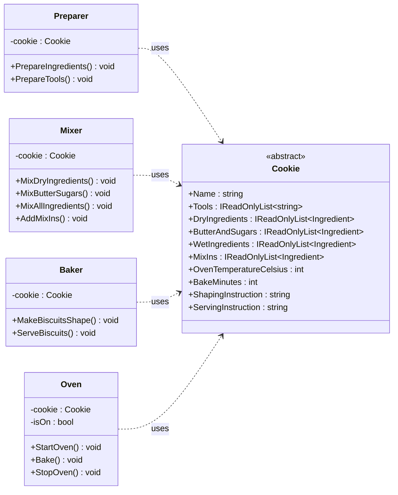
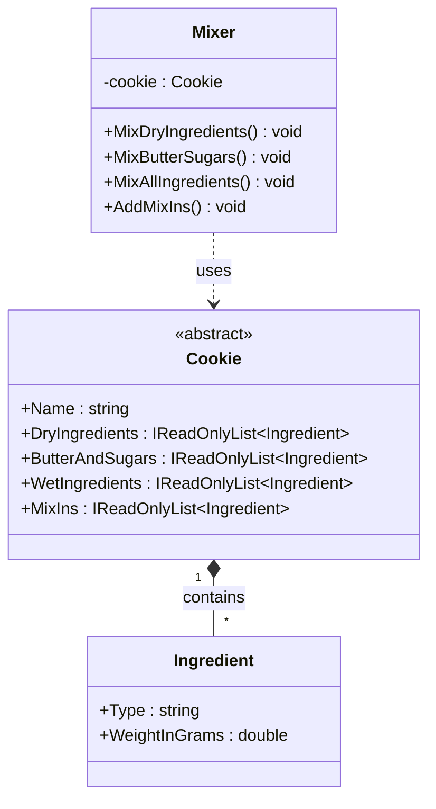
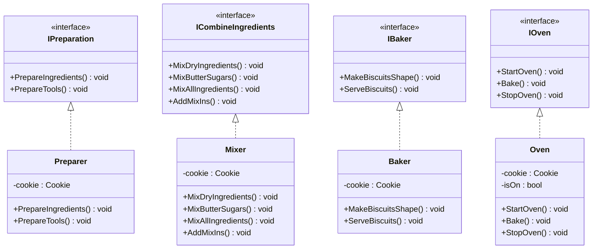

# Laboratory Work No.1 - SOLID principles

## Background

SOLID is a set of five object-oriented design principles popularised by Robert C. Martin: Single Responsibility, Open/Closed, Liskov Substitution, Interface Segregation and Dependency Inversion. They are guidelines for organising classes and interfaces so that code stays understandable and easy to change as a program grows.

They are used while designing the structure of an application: deciding what each class is responsible for, how classes depend on each other and how new features are added. Applying them keeps classes small and focused, reduces the risk that a change in one place breaks another, makes code easier to test and reuse, and lets teams extend a system without rewriting what already works. This is why SOLID is considered a foundation of maintainable software.

This laboratory work demonstrates three of the five principles (Single Responsibility, Open/Closed and Interface Segregation) in a small C# console application, a "cookie kitchen". The user chooses a cookie type from a menu (a chocolate chip cookie or an oatmeal raisin cookie, both based on real recipes), and the program prints the steps of preparing, mixing, shaping, baking and serving it.

## 1. Single Responsibility Principle

The Single Responsibility Principle states that a class should have only one reason to change. In the project, the work of a baker is split among four classes. `Preparer` only lists the ingredients and tools, `Mixer` only combines the ingredients into dough, `Baker` only shapes and serves the biscuits, and `Oven` only handles preheating, baking and switching off. The cookie classes only describe a recipe and perform no actions, and `Program` only shows the menu and calls the steps in order. If the format of the ingredient list changes, only `Preparer` is edited; if the mixing steps change, only `Mixer` is edited. A single class doing all of this would have three or four reasons to change.

## 2. Open/Closed Principle

The Open/Closed Principle states that software entities should be open for extension but closed for modification. In the project, `Mixer` (like the other worker classes) depends only on the abstract class `Cookie` and on the lists of ingredients it declares: dry ingredients, butter and sugars, wet ingredients and mix-ins. `ChocolateChipCookie` and `OatmealCookie` extend `Cookie` and fill in their own real recipe, the first with `Chocolate` chips as its mix-in and the second with raisins. `AddMixIns()` simply folds in whatever the cookie declares, so it contains no `if` or `switch` on the cookie type. A third cookie, for example a peanut butter one, can be added by creating one new class that extends `Cookie`, without changing `Mixer`, `Preparer`, `Baker`, `Oven` or `Cookie` itself.

## 3. Interface Segregation Principle

The Interface Segregation Principle states that no client should be forced to depend on methods it does not use, so many small, specific interfaces are better than one large general one. Instead of a single "baker" interface with every cooking action, the project defines four small interfaces: `IPreparation` (`PrepareIngredients()`, `PrepareTools()`), `ICombineIngredients` (the four mixing steps), `IBaker` (`MakeBiscuitsShape()`, `ServeBiscuits()`) and `IOven` (`StartOven()`, `Bake()`, `StopOven()`). Each interface is implemented by exactly one class, and every method of every interface is called by `Program`. As a result, `Oven` knows nothing about mixing, and a different oven (for example a gas oven) could implement `IOven` without having to implement shaping or mixing methods it has no use for.

## Conclusion

The cookie kitchen shows how three SOLID principles work together in a small program. Single Responsibility keeps preparing, mixing, shaping and baking in separate classes, so each has one reason to change. Open/Closed lets new cookie types be added by extending the abstract `Cookie` class instead of editing existing code. Interface Segregation keeps the interfaces small, so every class implements only the methods it really needs and every method is actually used. Together they make the code easy to read, easy to extend with new recipes and ovens, and safe to change, which is exactly what SOLID is meant to achieve.
