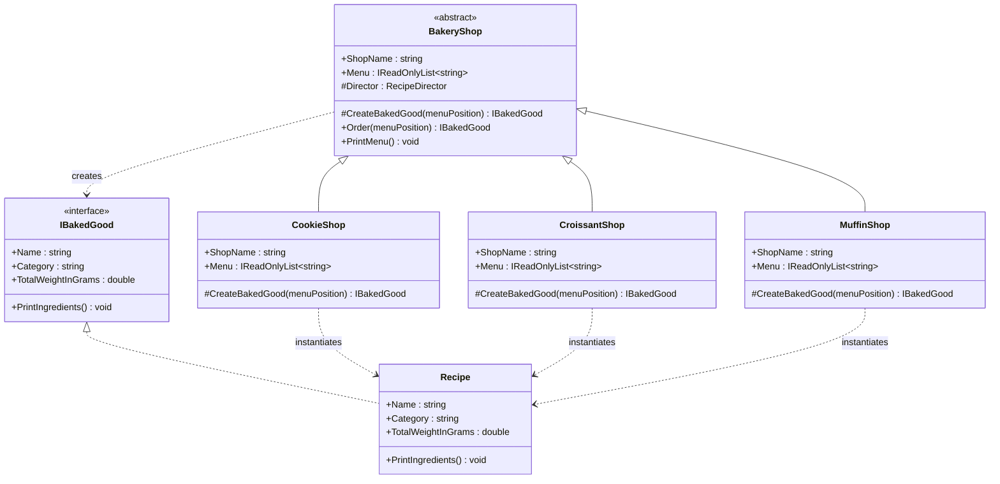
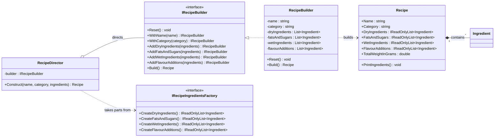
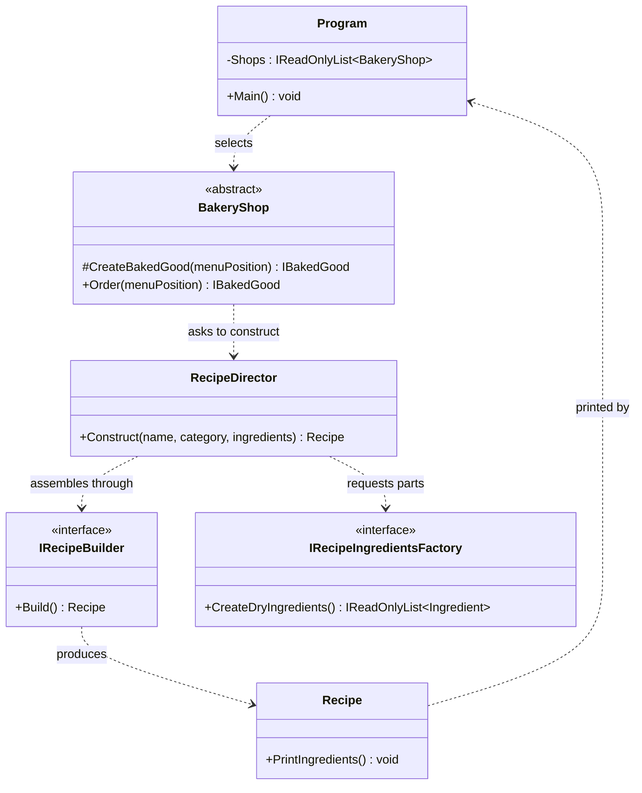

# Laboratory Work No.2 - Creational Design Patterns

## Background

Creational design patterns are the group of patterns that deal with object creation. Instead of letting a program scatter `new` expressions across its code, they move the decision of *what* to create and *how* to assemble it into dedicated classes. This matters because object creation is one of the places where code becomes rigid: a client that names concrete classes directly is tied to them, and every new variant forces the client to be edited.

They are applied while designing how a system produces its objects: when several related objects must be created together and must match each other, when an object has many parts and assembling it in a constructor would be unreadable, or when a family of classes shares a procedure but each member needs to produce a different object. Using them keeps the client code written against abstractions, lets new variants be added without touching existing classes, and keeps complex assembly logic in one place instead of spread across the program.

This laboratory work implements three creational patterns (Factory Method, Abstract Factory and Builder) in a small C# console application, a "bakery". The application continues the domain of Laboratory Work No.1, but shifts the focus from the preparation steps to the ingredients themselves. The user selects a shop, then selects a product from that shop's menu, and the program prints the full ingredient list of the chosen product, grouped into dry ingredients, fats and sugars, wet ingredients and flavour additions, together with the total weight of the batch. Six products are available, two in each of the three shops, and all of them use real recipe quantities.

## Project structure

```
Lab2/
│   ├── Models/      Ingredient.cs, IBakedGood.cs, Recipe.cs
│   ├── Factories/   IRecipeIngredientsFactory.cs + six concrete factories
│   ├── Builders/    IRecipeBuilder.cs, RecipeBuilder.cs, RecipeDirector.cs
│   └── Shops/       BakeryShop.cs, CookieShop.cs, CroissantShop.cs, MuffinShop.cs
│── Program.cs
└── report-lab2.md
```

## 1. Factory Method

The Factory Method pattern defines an interface for creating an object in a base class, but lets the subclasses decide which concrete class is actually instantiated. The base class works with the product only through an abstraction, so it never depends on the concrete types its subclasses produce.

In the project, `BakeryShop` is the abstract creator. It declares `CreateBakedGood(int menuPosition)` as a protected abstract method, and it uses that method inside `Order(int menuPosition)`, which first validates the position against the shop's menu and only then asks for the product. `CookieShop`, `CroissantShop` and `MuffinShop` are the concrete creators: each one declares its own two-item `Menu` and overrides `CreateBakedGood` to return the product that the chosen menu position stands for. The product type `IBakedGood` is the abstraction that `BakeryShop` and the client work with.

The benefit is visible in `Program`: the client holds a list of `BakeryShop` and calls `Order` on whichever shop the user picked, without ever knowing whether a cookie, a croissant or a muffin comes back. Adding a fourth shop, for example a bread shop, means writing one new subclass of `BakeryShop`; neither the base class nor the client has to be modified.



## 2. Abstract Factory

The Abstract Factory pattern provides an interface for creating a *family* of related objects without specifying their concrete classes. Its purpose is consistency: when several objects belong together, a single factory guarantees that the client receives a matching set and can never mix members of different families.

In the project, the family is the set of four ingredient groups that make up a recipe. `IRecipeIngredientsFactory` declares `CreateDryIngredients()`, `CreateFatsAndSugars()`, `CreateWetIngredients()` and `CreateFlavourAdditions()`, each returning a list of `Ingredient`. Six concrete factories implement it, one per product: `ChocolateChipCookieIngredientsFactory`, `OatmealRaisinCookieIngredientsFactory`, `ButterCroissantIngredientsFactory`, `PainAuChocolatIngredientsFactory`, `BlueberryMuffinIngredientsFactory` and `BananaNutMuffinIngredientsFactory`.

These groups genuinely have to match each other, which is what makes the pattern appropriate here rather than decorative. The rolled oats and cinnamon of the oatmeal recipe belong with raisins, not with 340 g of chocolate chips; the lamination butter block of a croissant belongs with bread flour and fresh yeast, not with browned butter and blueberries. Because every factory produces all four groups at once, no caller can assemble an inconsistent recipe.

`ButterCroissantIngredientsFactory` is worth noting: a plain butter croissant carries no filling, so `CreateFlavourAdditions()` returns an empty list. The family contract is still honoured, and the client is not forced to check whether the method applies. `Recipe.PrintIngredients` simply prints "none" for an empty group.

```mermaid
classDiagram
    direction TB

    class Ingredient {
        +Type : string
        +WeightInGrams : double
        +ToString() string
    }

    class IRecipeIngredientsFactory {
        <<interface>>
        +CreateDryIngredients() IReadOnlyList~Ingredient~
        +CreateFatsAndSugars() IReadOnlyList~Ingredient~
        +CreateWetIngredients() IReadOnlyList~Ingredient~
        +CreateFlavourAdditions() IReadOnlyList~Ingredient~
    }

    class ChocolateChipCookieIngredientsFactory {
        +CreateDryIngredients() IReadOnlyList~Ingredient~
        +CreateFatsAndSugars() IReadOnlyList~Ingredient~
        +CreateWetIngredients() IReadOnlyList~Ingredient~
        +CreateFlavourAdditions() IReadOnlyList~Ingredient~
    }

    class OatmealRaisinCookieIngredientsFactory {
        +CreateDryIngredients() IReadOnlyList~Ingredient~
        +CreateFatsAndSugars() IReadOnlyList~Ingredient~
        +CreateWetIngredients() IReadOnlyList~Ingredient~
        +CreateFlavourAdditions() IReadOnlyList~Ingredient~
    }

    class ButterCroissantIngredientsFactory {
        +CreateDryIngredients() IReadOnlyList~Ingredient~
        +CreateFatsAndSugars() IReadOnlyList~Ingredient~
        +CreateWetIngredients() IReadOnlyList~Ingredient~
        +CreateFlavourAdditions() IReadOnlyList~Ingredient~
    }

    class PainAuChocolatIngredientsFactory {
        +CreateDryIngredients() IReadOnlyList~Ingredient~
        +CreateFatsAndSugars() IReadOnlyList~Ingredient~
        +CreateWetIngredients() IReadOnlyList~Ingredient~
        +CreateFlavourAdditions() IReadOnlyList~Ingredient~
    }

    class BlueberryMuffinIngredientsFactory {
        +CreateDryIngredients() IReadOnlyList~Ingredient~
        +CreateFatsAndSugars() IReadOnlyList~Ingredient~
        +CreateWetIngredients() IReadOnlyList~Ingredient~
        +CreateFlavourAdditions() IReadOnlyList~Ingredient~
    }

    class BananaNutMuffinIngredientsFactory {
        +CreateDryIngredients() IReadOnlyList~Ingredient~
        +CreateFatsAndSugars() IReadOnlyList~Ingredient~
        +CreateWetIngredients() IReadOnlyList~Ingredient~
        +CreateFlavourAdditions() IReadOnlyList~Ingredient~
    }

    IRecipeIngredientsFactory <|.. ChocolateChipCookieIngredientsFactory
    IRecipeIngredientsFactory <|.. OatmealRaisinCookieIngredientsFactory
    IRecipeIngredientsFactory <|.. ButterCroissantIngredientsFactory
    IRecipeIngredientsFactory <|.. PainAuChocolatIngredientsFactory
    IRecipeIngredientsFactory <|.. BlueberryMuffinIngredientsFactory
    IRecipeIngredientsFactory <|.. BananaNutMuffinIngredientsFactory
    IRecipeIngredientsFactory ..> Ingredient : creates
```



## 3. Builder

The Builder pattern separates the construction of a complex object from its representation, so that the same construction process can produce different results. The object is assembled step by step through a builder, and an optional director encapsulates the order of those steps.

In the project, `Recipe` is the product being assembled. It is complex enough to justify the pattern: it carries a name, a category and four separate ingredient groups, which would make a six-argument constructor that is easy to call incorrectly. `IRecipeBuilder` declares the assembly steps (`WithName`, `WithCategory`, `AddDryIngredients`, `AddFatsAndSugars`, `AddWetIngredients`, `AddFlavourAdditions`), plus `Reset()` and `Build()`. `RecipeBuilder` implements them, accumulating the parts in private lists and returning `this` from every step so the calls can be chained.

`RecipeDirector` holds the construction procedure. Its `Construct(name, category, ingredients)` method resets the builder, sets the name and category, and then adds the four groups in a fixed order, taking each one from an `IRecipeIngredientsFactory`. This is where the two patterns meet: the abstract factory supplies the parts, the builder assembles them, and the director knows the order. Because the director depends only on the two interfaces, the same procedure builds all six products.

`Build()` is also where validation lives. It refuses to produce a recipe without a name or without dry ingredients, and it copies the accumulated lists into the new `Recipe` before resetting itself, so a builder reused for a second product cannot leak ingredients from the first. It also computes nothing itself: `Recipe.TotalWeightInGrams` sums the four groups on demand.



## How the three patterns work together

The patterns are not three isolated demonstrations; each one hands its result to the next. The client picks a shop, and **Factory Method** decides which product that shop's menu position stands for. To produce it, the shop asks the **Builder** (through its director) to assemble a `Recipe`, and the director takes the four ingredient groups from the **Abstract Factory** chosen for that product. The finished `Recipe` travels back to the client as an `IBakedGood`, which is the only type the client ever names.



## Results

The program starts by listing the shops, then the chosen shop's menu, then prints the ingredients of the selected product. A run for the pain au chocolat looks as follows:

```
=== Bakery ===

Which shop would you like to visit?
  1) Cookie shop
  2) Croissant shop
  3) Muffin shop
  0) Exit
Your choice: 2

Croissant shop
  1) Plain Butter Croissant
  2) Pain au Chocolat
  0) Back
Your choice: 2

--- Pain au Chocolat (Croissant) ---
  Dry:
    - Strong white bread flour (500 g)
    - Salt (6 g)
    - Easy-bake dried yeast (7 g)
  Fats and sugars:
    - Unsalted butter, lamination block (350 g)
    - Golden caster sugar (75 g)
  Wet:
    - Water (270 g)
  Flavour additions:
    - Dark chocolate batons (70%) (250 g)
  Total weight: 1458 g
```

The six products and their batch weights are:

| Shop | Product | Total weight |
|---|---|---|
| Cookie shop | Chocolate Chip Cookie | 1262 g |
| Cookie shop | Oatmeal Raisin Cookie | 1165 g |
| Croissant shop | Plain Butter Croissant | 1130 g |
| Croissant shop | Pain au Chocolat | 1458 g |
| Muffin shop | Blueberry Muffin | 1093 g |
| Muffin shop | Banana Nut Muffin | 1020 g |

## Conclusion

The bakery shows how three creational patterns divide the work of producing one object. Factory Method puts the choice of product in the subclass that knows about it, so `BakeryShop` and the client can work with `IBakedGood` alone and a new shop costs one new class. Abstract Factory keeps the four ingredient groups of a recipe together as a family, so no caller can combine the dry ingredients of one product with the flavour additions of another. Builder takes those groups and assembles them into a `Recipe` through a fixed, validated procedure, which keeps a six-part object out of a six-argument constructor.

The clearest measure of the result is what it costs to add a seventh product: one new class implementing `IRecipeIngredientsFactory` and one new line in the relevant shop's menu. The builder, the director, the base shop and the client stay untouched. That is what these patterns are meant to achieve, and it is also how they continue the Open/Closed Principle demonstrated in Laboratory Work No.1, now applied to object creation rather than to behaviour.
