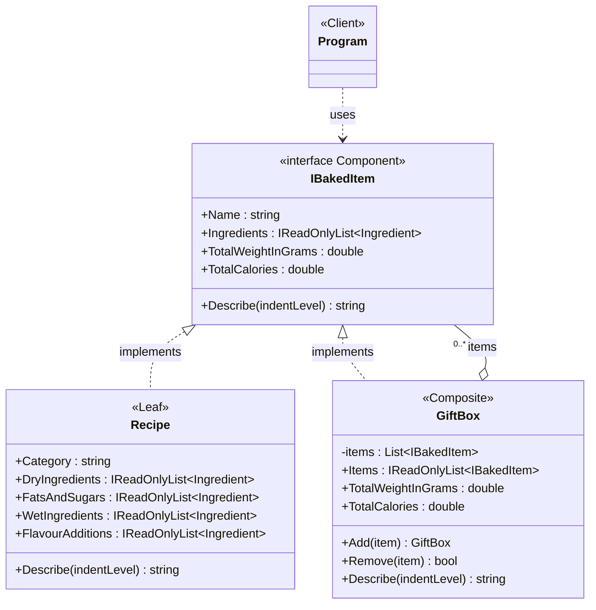
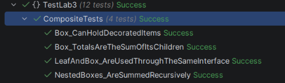
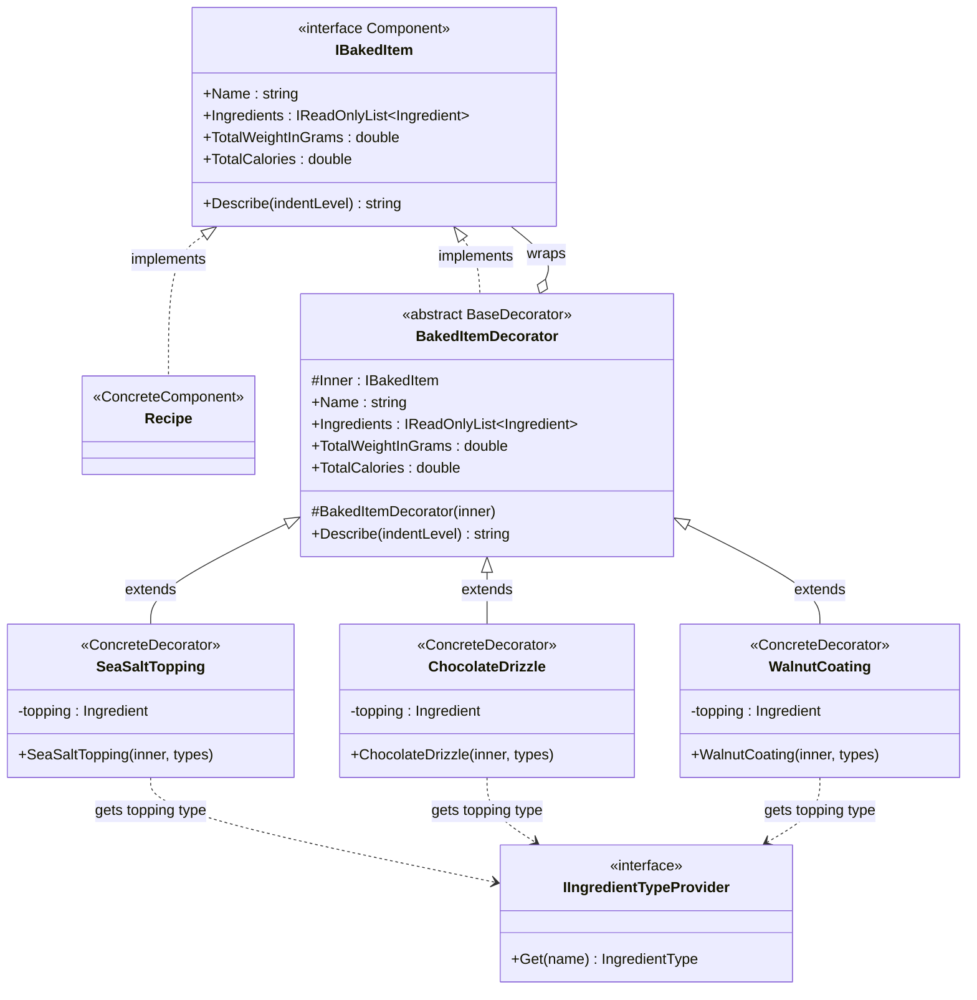
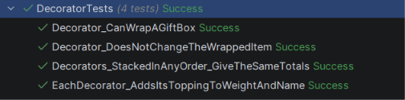
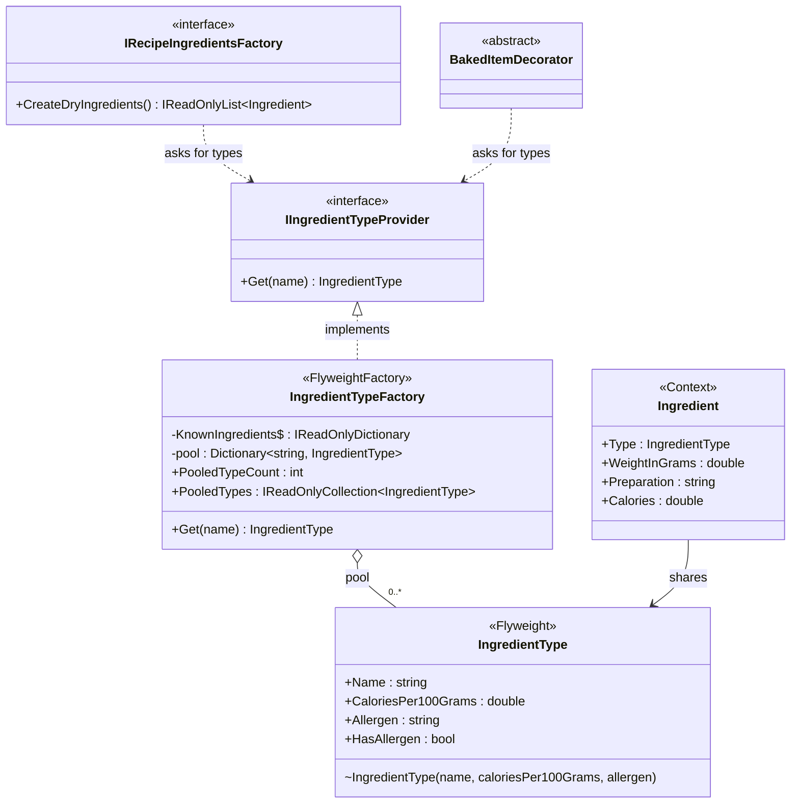
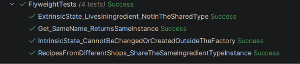
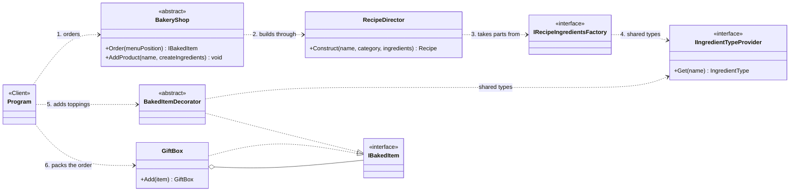

# Laboratory Work No.3 - Structural Design Patterns

## Background

Structural design patterns deal with how classes and objects are put together into larger structures. Creational patterns decide *what* gets created; structural patterns decide how the created objects are connected, wrapped and shared, so that the resulting structure stays flexible and the client can keep working through one simple interface.

They are applied when a program has to treat a single object and a group of objects the same way, when behaviour must be added to an object at run time without multiplying subclasses, when thousands of small objects repeat the same data, or when an existing class has to be fitted into an interface it was not written for. Used well, they keep the client code written against abstractions and let new variants be added as new classes instead of edits to existing ones.

This laboratory work implements three structural patterns (Composite, Decorator and Flyweight) in a small C# console application, the same "bakery" as in Laboratory Work No.2. The creational part is reused as it was: shops create products through the Factory Method, every product is assembled by a Builder and its Director, and its ingredients come from an Abstract Factory. On top of it the customer can now:

- choose a shop and a product, then add toppings to it (sea salt, chocolate drizzle, walnut coating) in any order and any number;
- put several products, each with its own toppings, into a named gift box;
- view the whole order as a tree, with its total weight, calories, allergens and the number of shared ingredient types in memory.

Six products are available, two in each of three shops. A scripted demonstration of each pattern is also available from the main menu. Build, run and test instructions are in [`README.md`](README.md).

## Project structure

```
Lab3/                          solution folder
├── Lab3.sln
├── README.md                  build, run and test instructions
├── report-lab3.md             this report
├── docs/images/               screenshots of the passing tests
├── Lab3/                      console application
│   ├── Client/                Program.cs (interactive menu + scripted demo)
│   ├── Domain/
│   │   ├── Models/            IBakedItem.cs, Recipe.cs, Ingredient.cs, Indent.cs
│   │   ├── Factories/         IRecipeIngredientsFactory.cs + six concrete factories   (Lab 2)
│   │   ├── Builders/          IRecipeBuilder.cs, RecipeBuilder.cs, RecipeDirector.cs  (Lab 2)
│   │   └── Shops/             BakeryShop.cs, CookieShop.cs, CroissantShop.cs, MuffinShop.cs (Lab 2)
│   └── Patterns/
│       ├── Composite/         GiftBox.cs
│       ├── Decorator/         BakedItemDecorator.cs, SeaSaltTopping.cs, ChocolateDrizzle.cs, WalnutCoating.cs
│       └── Flyweight/         IngredientType.cs, IIngredientTypeProvider.cs, IngredientTypeFactory.cs
└── TestLab3/                  NUnit test project
    ├── CompositeTests.cs
    ├── DecoratorTests.cs
    ├── FlyweightTests.cs
    └── TestDoubles/           StubBakedItem.cs
```

The common abstraction of the whole application is `IBakedItem`. A recipe, a decorated recipe and a gift box are all `IBakedItem`, which is what lets the three patterns plug into each other:

```csharp
public interface IBakedItem
{
    string Name { get; }
    IReadOnlyList<Ingredient> Ingredients { get; }
    double TotalWeightInGrams { get; }
    double TotalCalories { get; }
    string Describe(int indentLevel);
}
```

In C# a property in an interface is not a field; `string Name { get; }` is compiled into a `get_Name()` method. The interface therefore still declares only behaviour, and every implementation computes the values its own way: `Recipe` sums its ingredients, `GiftBox` sums its children, a decorator adds its topping to the item it wraps. `Describe` returns text instead of printing it, so the models do no console output; printing is done only by `Program`.

## 1. Composite

The Composite pattern composes objects into tree structures and lets the client treat a single object and a group of objects uniformly, through one interface. The client does not need to know whether it holds a leaf or a whole subtree.

**The problem it solves here.** A customer orders single products, but also gift boxes that contain several products, and a box may itself contain another box. Without the pattern, every piece of code that computes a weight, lists ingredients or prints the order would have to check "is this a product or a box?" and recurse by hand. With it, `GiftBox` implements the same `IBakedItem` as a `Recipe`, so a box *is* a baked item: it answers `TotalWeightInGrams`, `TotalCalories`, `Ingredients` and `Describe` by delegating to its children. The customer's whole order is itself a `GiftBox` named "My order", so viewing the order is a single call to `order.Describe(0)`.

| Role | Class |
|---|---|
| Component | `IBakedItem` |
| Leaf | `Recipe` |
| Composite | `GiftBox` |
| Client | `Program` |

### Class diagram



### Code snippet

[`Lab3/Patterns/Composite/GiftBox.cs`](Lab3/Patterns/Composite/GiftBox.cs#L19-L47)

```csharp
public GiftBox Add(IBakedItem item)
{
    items.Add(item ?? throw new ArgumentNullException(nameof(item)));
    return this;
}

public IReadOnlyList<Ingredient> Ingredients =>
    items.SelectMany(item => item.Ingredients).ToList();

public double TotalWeightInGrams => items.Sum(item => item.TotalWeightInGrams);

public double TotalCalories => items.Sum(item => item.TotalCalories);

public string Describe(int indentLevel)
{
    StringBuilder text = new StringBuilder();

    text.AppendLine(
        $"{Indent.Of(indentLevel)}[{Name}] - {items.Count} item(s), {TotalWeightInGrams} g");

    foreach (IBakedItem item in items)
    {
        text.Append(item.Describe(indentLevel + 1));
    }

    return text.ToString();
}
```

The box stores its children as `IBakedItem`, never as `Recipe` or `GiftBox`, and every member simply asks each child the same question. Because a child can be another `GiftBox`, the recursion through nested boxes happens by itself, with no type checks anywhere.

### Unit tests

File: [`TestLab3/CompositeTests.cs`](TestLab3/CompositeTests.cs)

| Test | What it checks |
|---|---|
| `LeafAndBox_AreUsedThroughTheSameInterface` | A real recipe and a gift box are put in one `List<IBakedItem>` and read the same way (name, weight, calories, ingredients, description), with no type checks. |
| `Box_TotalsAreTheSumOfItsChildren` | A box of a 100 g and a 250 g item weighs 350 g, and its calories are the sum of its children's. |
| `NestedBoxes_AreSummedRecursively` | A box inside a box: the outer box has 2 direct items but its totals include every item of the inner box. |
| `Box_CanHoldDecoratedItems` | A decorated item (100 g + sea salt) inside a box is counted with its topping: 104 g + 50 g = 154 g. |



## 2. Decorator

The Decorator pattern attaches additional responsibilities to an object at run time by wrapping it in another object with the same interface. Decorators can be stacked in any combination, which avoids an explosion of subclasses.

**The problem it solves here.** Every product can get toppings, in any order and any number: a cookie with sea salt, a cookie with sea salt and chocolate drizzle, a muffin with walnuts. Creating a subclass for every combination (`SaltedChocolateChipCookie`, `SaltedDrizzledChocolateChipCookie`, ...) is impossible to maintain. Instead, each topping is a decorator that wraps any `IBakedItem`, adds its own ingredient to the list, its weight and calories to the totals and its name to the product name, and otherwise passes everything through to the wrapped item. The customer chooses toppings at run time from the menu, and each choice wraps the current item once more.

| Role | Class |
|---|---|
| Component | `IBakedItem` |
| Concrete component | `Recipe` (also `GiftBox`, which can be decorated too) |
| Base decorator | `BakedItemDecorator` (abstract) |
| Concrete decorators | `SeaSaltTopping`, `ChocolateDrizzle`, `WalnutCoating` |

### Class diagram



### Code snippet

[`Lab3/Patterns/Decorator/BakedItemDecorator.cs`](Lab3/Patterns/Decorator/BakedItemDecorator.cs#L5-L23) and [`Lab3/Patterns/Decorator/ChocolateDrizzle.cs`](Lab3/Patterns/Decorator/ChocolateDrizzle.cs#L6-L29)

```csharp
public abstract class BakedItemDecorator : IBakedItem
{
    protected BakedItemDecorator(IBakedItem inner)
    {
        Inner = inner ?? throw new ArgumentNullException(nameof(inner));
    }

    protected IBakedItem Inner { get; }

    public virtual double TotalWeightInGrams => Inner.TotalWeightInGrams;
    // ... every member delegates to Inner by default
}

public class ChocolateDrizzle : BakedItemDecorator
{
    private readonly Ingredient topping;

    public ChocolateDrizzle(IBakedItem inner, IIngredientTypeProvider types)
        : base(inner)
    {
        topping = new Ingredient(types.Get("Dark chocolate"), 45, "melted, drizzled");
    }

    public override string Name => $"{Inner.Name} + chocolate drizzle";

    public override double TotalWeightInGrams =>
        Inner.TotalWeightInGrams + topping.WeightInGrams;
}
```

The decorator is a wrapper, not a subclass of `Recipe`: it holds the wrapped item as an `IBakedItem` and is itself an `IBakedItem`, so a decorated item can be wrapped again. Each override first asks `Inner` and then adds the topping's contribution, which is why the result is correct whatever was wrapped and in whatever order.

In the client, the available toppings are a list of names paired with a function that creates the decorator, so a new topping costs one new decorator class and one line in that list:

```csharp
("Sea salt", (item, types) => new SeaSaltTopping(item, types)),
("Chocolate drizzle", (item, types) => new ChocolateDrizzle(item, types)),
("Walnut coating", (item, types) => new WalnutCoating(item, types))
```

### Unit tests

File: [`TestLab3/DecoratorTests.cs`](TestLab3/DecoratorTests.cs)

| Test | What it checks |
|---|---|
| `EachDecorator_AddsItsToppingToWeightAndName` | On a 100 g item, sea salt gives 104 g, chocolate drizzle 145 g and walnut coating 130 g, and each appends its name ("Plain + sea salt", ...). |
| `Decorators_StackedInAnyOrder_GiveTheSameTotals` | Salt → drizzle → walnut and walnut → drizzle → salt give the same weight (179 g), the same calories and the same set of ingredients. |
| `Decorator_DoesNotChangeTheWrappedItem` | Wrapping a real Chocolate Chip Cookie in two toppings leaves the cookie's own weight and ingredient count unchanged; only the wrapper has 2 extra ingredients. |
| `Decorator_CanWrapAGiftBox` | A gift box of two 100 g items wrapped in chocolate drizzle becomes "Box + chocolate drizzle" weighing 245 g (Decorator working on a Composite). |



## 3. Flyweight

The Flyweight pattern shares the common part of many fine-grained objects instead of storing it in every one of them. The shared, unchangeable part is the *intrinsic* state; the part that differs from one use to another is the *extrinsic* state and is kept outside the flyweight.

**The problem it solves here.** Every recipe line is an `Ingredient`, and the same ingredient appears in many recipes and toppings: unsalted butter is used in 7 recipe lines, salt in all six products and again in the sea salt topping, all-purpose flour and granulated sugar in five products each, eggs and vanilla in four. The data that describes *what* an ingredient is (its name, calories per 100 g and allergen) is the same everywhere. Only the quantity and the preparation ("melted", "cold", "2 eggs") change from one recipe line to the next.

So the description of an ingredient is an `IngredientType` flyweight, created once per name by `IngredientTypeFactory` and shared by every recipe line that uses it. An `Ingredient` keeps only a reference to its shared type, plus its own weight and preparation. The allergen list of the whole order is also read from these shared types, so an allergen is declared exactly once in the program.

| Role | Class |
|---|---|
| Flyweight | `IngredientType` (intrinsic: `Name`, `CaloriesPer100Grams`, `Allergen`) |
| Flyweight factory | `IngredientTypeFactory`, used through `IIngredientTypeProvider` |
| Context (extrinsic state) | `Ingredient` (`WeightInGrams`, `Preparation`, and a reference to the type) |
| Clients | the six ingredient factories, the three decorators, the shops |

### Class diagram



### Code snippet

[`Lab3/Patterns/Flyweight/IngredientTypeFactory.cs`](Lab3/Patterns/Flyweight/IngredientTypeFactory.cs#L33-L54)

```csharp
private readonly Dictionary<string, IngredientType> pool =
    new Dictionary<string, IngredientType>(StringComparer.OrdinalIgnoreCase);

public IngredientType Get(string name)
{
    if (pool.TryGetValue(name, out IngredientType? pooled))
    {
        return pooled;
    }

    if (!KnownIngredients.TryGetValue(name, out (double Calories, string Allergen) data))
    {
        throw new ArgumentException(
            $"'{name}' is not a known ingredient of this bakery.",
            nameof(name));
    }

    IngredientType created = new IngredientType(name, data.Calories, data.Allergen);
    pool[name] = created;

    return created;
}
```

This is the lookup-or-create step: a type is built only the first time its name is requested, and every later request returns the same instance from the pool. `IngredientType` has only getters and an `internal` constructor, so outside the project nobody can change a shared type or create one behind the factory's back; the weight and preparation live in `Ingredient`, whose calories are computed as `Type.CaloriesPer100Grams * WeightInGrams / 100`.

### Unit tests

File: [`TestLab3/FlyweightTests.cs`](TestLab3/FlyweightTests.cs)

| Test | What it checks |
|---|---|
| `Get_SameName_ReturnsSameInstance` | Two requests for "All-purpose flour" return the very same object (`Is.SameAs`). |
| `IntrinsicState_CannotBeChangedOrCreatedOutsideTheFactory` | `IngredientType` has no writable property and no public constructor, so the shared state is immutable. |
| `ExtrinsicState_LivesInIngredient_NotInTheSharedType` | Two `Ingredient`s of 100 g and 250 g of flour share one type, yet have their own weights and calories (364 and 910 kcal). |
| `RecipesFromDifferentShops_ShareTheSameIngredientTypeInstance` | The flour of the Chocolate Chip Cookie (cookie shop) and of the Blueberry Muffin (muffin shop) is the same object. |



## How the patterns work together

The patterns are not isolated demonstrations; one order passes through all of them. The customer picks a shop and a product, and the shop's **Factory Method** asks the **Builder** (through its director) to assemble a `Recipe`, taking the four ingredient groups from the product's **Abstract Factory**. Every ingredient line the factory creates gets its description from the **Flyweight** pool. The customer then adds toppings, and each one wraps the recipe in a **Decorator** that also takes its ingredient from the same pool. Finally the decorated product goes into a gift box or straight into the order, which is itself a gift box, the **Composite**. A decorator can even wrap a whole gift box (shown in the scripted demo), because both are `IBakedItem`.



The client depends only on abstractions for everything it reads: it handles products, decorated products and boxes as `IBakedItem`, and decorators receive the flyweight factory as `IIngredientTypeProvider`. The project is open for extension in the places that change most often:

- a new topping is one new subclass of `BakedItemDecorator` and one line in the topping list;
- a new product is one new `IRecipeIngredientsFactory` and one `AddProduct(...)` call, with no `switch` to edit;
- a new kind of container (for example a tray) would be one more class implementing `IBakedItem`.

## Results

### Products

| Shop | Product | Batch weight |
|---|---|---|
| Cookie shop | Chocolate Chip Cookie | 1262 g |
| Cookie shop | Oatmeal Raisin Cookie | 1165 g |
| Croissant shop | Plain Butter Croissant | 1130 g |
| Croissant shop | Pain au Chocolat | 1458 g |
| Muffin shop | Blueberry Muffin | 1091 g |
| Muffin shop | Banana Nut Muffin | 1020 g |

| Topping (decorator) | Ingredient (flyweight) | Adds |
|---|---|---|
| Sea salt | Salt, flaky | 4 g |
| Chocolate drizzle | Dark chocolate, melted | 45 g |
| Walnut coating | Walnuts, chopped | 30 g |

## Conclusion

The bakery shows three structural patterns each solving a real problem of the same order. Composite lets a box of products, or a box of boxes, behave exactly like one product, so the order can be weighed, listed and printed without a single type check. Decorator adds toppings at run time in any order and number, keeping the product classes unchanged and avoiding a subclass for every combination. Flyweight keeps the description of each ingredient in one shared, unchangeable object, so recipes and toppings only store how much they use.

**What was harder than expected.** The hardest part was making the patterns cooperate rather than sit side by side. The toppings needed real ingredients with calories and allergens, which meant the decorators had to take their ingredient from the flyweight pool; to keep them independent of the concrete pool, the `IIngredientTypeProvider` interface was introduced. Output was another difficulty: the first version had a `Print` method in `IBakedItem`, so every model, decorator and box wrote to the console. Replacing it with `Describe`, which returns text, separated the models from the console and made them testable.

**What I would design differently.** A Facade (`BakeryFacade`) was part of the first version. It only passed calls through to the shops while still exposing the shops and the flyweight factory, and the client went around it, so it hid nothing. Since it did not solve a real problem in this project, it was removed instead of being kept as a fourth, forced pattern. Another point is the decorator on a whole gift box: it works and shows Decorator and Composite together, but a chocolate drizzle "on a box" makes little sense for a customer, so it stays in the scripted demo and is not offered in the interactive menu. Finally, the list of known ingredients is still written directly in `IngredientTypeFactory`; loading it from a configuration file would let new ingredients be added without recompiling.
